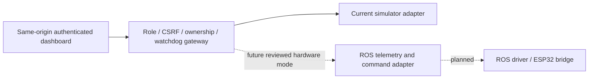

# Raspberry Pi 4 readiness — Phase 5C

Assessment date: 2026-11-22. **Prepared for a future supervised ARM64 simulation deployment; not deployed or performance-qualified on a Pi. Hardware integration remains disabled.** No Pi, ROS node, UART, ESP32, GPIO, motor, physical LiDAR or camera was accessed.

## Current architecture and compatibility

The production service consists of one foreground supervisor, one Uvicorn worker with one authoritative `RobotSimulator`, and Caddy for HTTPS/WSS. There is no reload worker or second motion engine. React is built once and served as static assets by FastAPI. Accounts and TLS/CA state are separate from robot JSON and SQLite. Both LAN roles authenticate; Observers cannot control or STOP.

| Area | Evidence and readiness |
| --- | --- |
| OS / architecture | Target Ubuntu 22.04 ARM64 fits the planned Humble/Python 3.10 environment. Laptop tests ran on Ubuntu 22.04.5 x86-64, not ARM. Consult [ROS REP-2000](https://github.com/ros-infrastructure/rep/blob/master/rep-2000.rst) and review the published Humble May 2027 support horizon before future rollout. |
| Python | All 29 locked package versions' PyPI metadata declares Python 3.10-compatible minimum versions and offers candidate universal or Linux ARM64 wheels. See [the recorded metadata](acceptance/phase5c/arm64-metadata.json), including source URLs. Native candidates include pydantic_core, uvloop, httptools, watchfiles and PyYAML. This checks publication metadata, not ARM installation, ABI loading, dependency resolution or execution. |
| SQLite | Host SQLite 3.37.2 has JSON1, WAL and online backup support. SQL JSON functions are now required for efficient archive reads; startup fails clearly if absent. Run the feature probe below on the future host. [JSON support](https://www.sqlite.org/json1.html) is built in by default from SQLite 3.38; older builds need JSON1 enabled. No system SQLite upgrade was performed. |
| Caddy | Use the approved release's `linux_arm64` binary, verify its official checksum before execution, and keep it outside version control. The laptop binary is AMD64 and cannot be copied to ARM64. See [official releases](https://github.com/caddyserver/caddy/releases/tag/v2.11.9) and [installation documentation](https://caddyserver.com/docs/install). No ARM binary was executed. |
| Frontend | Build using Node.js 24 and the existing npm lockfile, either on a sufficiently provisioned Pi or another build host. Copy the matching complete `frontend/dist` artifact. Node/npm are unnecessary for production runtime with built assets. The npm lock also contains ARM64 GNU optional entries for esbuild, Rollup and Tailwind oxide; actual ARM installation is still unverified. Do not copy an x86 Python venv or node_modules to ARM. |
| Networking | Prefer a router **DHCP reservation** plus a stable private name such as `amr.home.arpa`. Exact allowed Host/Origin, private bind, loopback backend and trusted HTTPS are mandatory. Startup auto detection is available for supported networks but does not configure router DNS. |
| CPU / RAM | Laptop measurements are in the final report; they are not Pi capacity estimates. Pi RAM size and target storage are unspecified. Measure on the actual device with realistic users, thermal conditions and storage before setting capacity expectations. |
| Storage | Mission archive and logs grow persistently. History JSON responses are bounded, but full CSV export and daily archive aggregation still scale with archive size. Define retention/export policy before prolonged use; do not delete history automatically. Use durable storage, free-space monitoring and verified backups. |

On the future host, after explicit deployment approval and project-local dependency setup:

```bash
cd ~/Projects/PBL4_Dashboard
env -u PYTHONPATH backend/.venv/bin/python - <<'PY'
import platform, sqlite3
print(platform.machine(), platform.python_version(), sqlite3.sqlite_version)
with sqlite3.connect(':memory:') as db:
    print('SQLite JSON available:', db.execute("SELECT json_valid('{}')").fetchone()[0] == 1)
PY
```

Do not source a ROS setup into this service. The launchers remove inherited `PYTHONPATH`. A future ROS adapter needs a separately reviewed compatible environment; ROS being installed does not activate it.

## Deployment and operations plan

Use [PHASE5B2_DEPLOYMENT.md](PHASE5B2_DEPLOYMENT.md) for exact private configuration, account provisioning/migration, certificate trust, local and LAN startup. Preserve the existing account store and CA/root fingerprint; never regenerate a CA as an IP-change fix. Reprovision the correct platform binaries and venv; migrate data through a verified backup after graceful shutdown.

Keep one backend worker. A future permanent service must run under a dedicated unprivileged identity, keep the supervisor as its main process, pass SIGTERM to it, allow enough time for proxy shutdown plus SQLite flushing, and contain both children in its service cgroup. No system service was created here. Automatic service restart must preserve the application's stopped/interrupted recovery and require new login; it must never launch queued work automatically. Any systemd, firewall, boot or privilege changes require separate approval.

Current logging goes to the foreground terminal. A future service needs an approved journal/file retention policy, storage quotas and rate limits; no global journald/logrotate settings were changed. Do not let redirected logs fill the SD card. Use existing `ps`, `top`, `free -h`, `df -h` and journal tooling after provisioning to monitor real host resources. The Dashboard's CPU/RAM/temperature/battery charts remain **synthetic** and must not be used to evaluate Pi health.

Before approving Pi simulation hosting: run the complete suite, the bounded 30-second workflow, then a supervised longer run; confirm filesystem permissions, certificate identity/renewal, private DNS, STOP/disconnect, graceful shutdown and backup restore on the actual device. Do not infer performance from the laptop's Ryzen CPU or RAM.

## Backup and recovery

The mission/configuration helper uses SQLite's online backup API (including committed WAL content), closes both connections explicitly, creates a private directory and files, and refuses an existing destination. Stop the service for a coherent database-plus-JSON point-in-time backup. See [Python's backup API](https://docs.python.org/3.10/library/sqlite3.html#sqlite3.Connection.backup).

```bash
cd ~/Projects/PBL4_Dashboard/backend
# Select a NEW private destination. Existing source-path environment overrides are honored.
env -u PYTHONPATH .venv/bin/python -m app.backup "$HOME/.config/pbl4/backup-NEW_TIMESTAMP"
```

Back up the private LAN env, account JSON and complete Caddy runtime/CA/fingerprint separately to protected storage. Coordinate account administration during that copy. The mission helper intentionally does not export accounts or keys. Keep secret directories mode 700 and account/env/key files mode 600. Verify a CA's public fingerprint through a trusted channel; transfer only its public root to browsers.

To rehearse recovery, use a new isolated directory and an unused loopback port. Do not restore over production files:

```bash
PBL4_BACKUP_DIR=/absolute/private/verified-backup
PBL4_RECOVERY_DIR="$(mktemp -d /tmp/pbl4-recovery.XXXXXX)"
cp "$PBL4_BACKUP_DIR/missions.sqlite3" "$PBL4_RECOVERY_DIR/missions.sqlite3"
cp "$PBL4_BACKUP_DIR/robot-config.json" "$PBL4_RECOVERY_DIR/robot-config.json"
cd ~/Projects/PBL4_Dashboard
MISSION_DB_PATH="$PBL4_RECOVERY_DIR/missions.sqlite3" \
ROBOT_CONFIG_PATH="$PBL4_RECOVERY_DIR/robot-config.json" \
DASHBOARD_PORT=18080 ./start-dashboard.sh --no-build
```

Verify SQLite integrity, Home/waypoint headings, queue/templates/history and stopped/interrupted recovery before acceptance. This local recovery rehearsal deliberately uses the loopback developer mode; never proxy it onto LAN. Stop it before removing its temporary files. Actual restoration of production credentials or certificates remains a separate administrator action with verified backups.

## Future ROS 2 / ESP32 boundary — design only

The simulator remains the only active provider. Do not import rclpy or open serial/camera devices in this phase. A future implementation should put provider selection, normalized telemetry and command routing behind explicit adapters, rather than adding a second state engine or letting browser components issue ROS commands.



| Planned interface | Future mapping / checks |
| --- | --- |
| `/cmd_vel` (`geometry_msgs/Twist`) | Command gateway only: normalized m/s and rad/s, authenticated Operator ownership, differential wheel limits including combined v/omega, explicit release/STOP, heartbeat timeout and fault inhibition. Observers never publish. |
| `/odom` (`nav_msgs/Odometry`) | Measured velocity and odom-frame pose with timestamps/covariance/provenance. Do not mix it silently with simulator pose. |
| `/map` (`nav_msgs/OccupancyGrid`) | Resolution, origin and occupancy values mapped into the existing map contract; validate footprint clearance and map identity before command acceptance. |
| `/tf` / TF transforms | Resolve map → odom → base_link and sensor frames at consistent times; stale/missing TF must become an unavailable/fault state, not invented coordinates. |
| `/scan` (`sensor_msgs/LaserScan`) | Preserve radians/meters, angular limits, range validity, frame ID and age. The current 181-beam/180°/5 m/5 Hz defaults are virtual settings, not physical LiDAR specifications. |
| `/joint_states` (`sensor_msgs/JointState`) | Normalize independent wheel positions/velocities and encoder direction. Preserve raw configurable polarity (left +1, right −1) separately from normalized differential-drive odometry. |
| Camera Image / CompressedImage topics | A bounded latest-frame backend adapter with authentication and clear source/freshness metadata. Camera remains NOT CONNECTED/PLACEHOLDER now. No fabricated frame timestamps or detections. |
| ESP32-S3 N16R8, future UART 57600 | Separate reviewed driver/bridge. Validate firmware framing, wheel conventions, command limits, sequence numbers, timeouts and fault responses before motion. No UART implementation exists here. |
| PI diagnostics | Report real firmware Kp, Ki, PWM, error and integral term with provenance only when available. Existing acceleration-limited dynamics are not the ESP32 PI controller. Unavailable fields stay unavailable. |

Hardware mode must be a deliberate new phase with an explicit enable gate. The current frontend requires `simulation=true`; future hardware support needs a versioned source contract and deliberate safety review, not removal of that guard as a shortcut. Keep only one authoritative normalized robot state, bounded ingress buffers, timestamp/freshness validation and no automatic mode fallback or motion resume. Use structured hardware faults and measured host health instead of relabeling synthetic fields as measurements.

Application STOP is not a physical emergency stop. A real robot needs independent ESP32/motor watchdogs, safe boot, loss-of-communications behavior, fault inhibition, physical emergency-stop provisions and supervised hardware validation. ROS/DDS command access also needs its own security review; dashboard login alone does not secure arbitrary ROS publishers. The simulator's simple A* and path follower do not claim production Nav2 behavior. No real command path is enabled by these documents.
